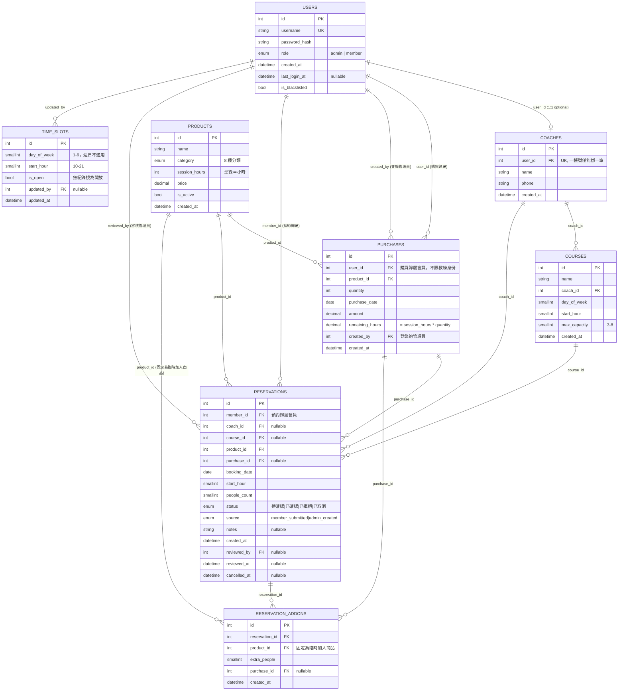
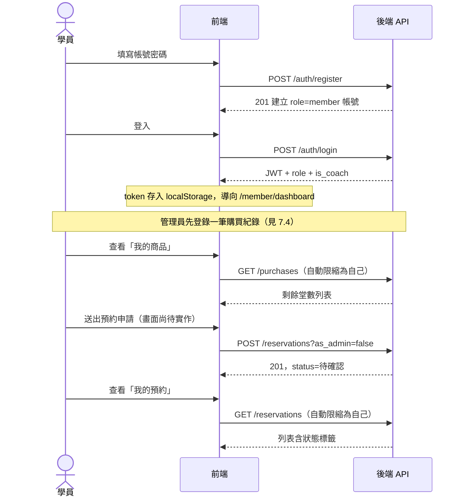
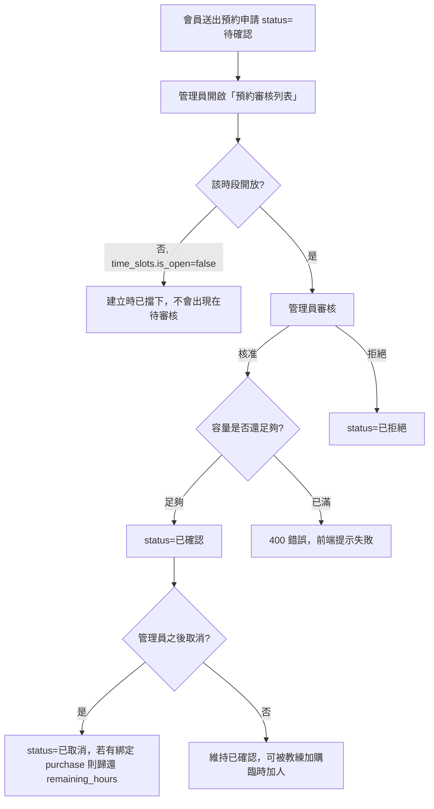

# 健身工作室管理系統 — 產品需求文件（PRD）

> 本文件整理專案目前的功能、操作流程、資料庫、API、前端設計與各角色使用情境，作為專案文件化的單一參考來源。內容依實際程式碼（backend/frontend）盤點而來，非規格先行文件；若與程式碼有落差，以程式碼為準，並回頭更新本文件。
>
> 最後盤點日期：2026-08-05

---

## 目錄

1. [專案概述](#1-專案概述)
2. [技術架構](#2-技術架構)
3. [使用者角色與權限模型](#3-使用者角色與權限模型)
4. [資料庫設計](#4-資料庫設計)
5. [API 規格](#5-api-規格)
6. [前端設計](#6-前端設計)
7. [核心使用情境（User Flows）](#7-核心使用情境user-flows)
8. [目前實作狀態](#8-目前實作狀態)
9. [已知缺口與待辦](#9-已知缺口與待辦)

---

## 1. 專案概述

健身工作室管理系統，供小型健身工作室管理「會員／場租教練預約」「商品／堂數銷售」「教練與課程資料」。系統分兩種使用角色：

- **管理員（admin）**：唯一由後台管理的帳號類型，負責教練/商品/課程資料維護、會員管理、預約審核、時段開放設定、購買紀錄登錄。
- **會員（member）**：透過註冊頁自行建立帳號。會員底下再分兩種**衍生身份**（不落欄位，由是否綁定 `coaches` 資料衍生）：
  - **學員**：一般會員，購買商品堂數後送出預約申請。
  - **場租教練**：由管理員在後台將某會員帳號綁定一筆 `coaches` 資料後，該帳號即具備教練身份，額外擁有「加購臨時加人」功能。

系統核心運作邏輯：商品（堂數/服務）→ 會員購買（產生 `purchases.remaining_hours`）→ 會員或教練依開放時段送出預約申請 → 管理員審核（核准會佔用容量，拒絕/取消則釋放）。

---

## 2. 技術架構

| 層 | 技術 |
|---|---|
| 前端 | React + TypeScript + Vite + Ant Design（含 `zh_TW` locale）、TanStack Query（資料抓取/快取）、Zustand（登入狀態，持久化至 localStorage）、React Router |
| 後端 | FastAPI（Python）、SQLAlchemy ORM、Pydantic schema、Alembic migration |
| 資料庫 | MySQL 8.4（正式/Docker）；本機非 Docker 開發預設 SQLite |
| 認證 | JWT（HS256，`python-jose`），密碼雜湊 bcrypt（`passlib`） |
| 容器化 | Docker Compose：`mysql`、`backend`、`frontend`（nginx 反向代理 `/api/*`）、`adminer`（資料庫瀏覽 UI） |

### 專案目錄結構

```
backend/app/
  models/     SQLAlchemy ORM model，一張表一個檔
  schemas/    Pydantic request/response model，一個資源一個檔（XCreate/XUpdate/XOut）
  routers/    FastAPI route handler，一個資源一個檔
  core/       config.py（環境設定）、security.py（JWT + bcrypt）
  deps.py     共用 FastAPI dependency（登入驗證、角色守衛）
  db/session.py  SQLAlchemy engine/session
  alembic/    migration（autogenerate 產生）

frontend/src/
  api/        一個資源一個檔，薄封裝的 axios 呼叫
  pages/admin/    管理員專用畫面
  pages/member/   會員專用畫面
  pages/common/   Login、Register
  components/     共用元件：AppLayout、SlotPicker、StatusTag
  store/auth.ts   Zustand 登入狀態（persist 到 localStorage）
  router/index.tsx  路由表；RequireRole.tsx 做角色守衛
```

### 部署方式

```bash
docker compose up --build
```

| 服務 | 位址 | 說明 |
|---|---|---|
| 前端 | http://localhost | nginx 提供靜態檔並反向代理 `/api/*` 到 backend |
| 後端 API 文件 | http://localhost:8000/docs | FastAPI 自動產生的 Swagger UI |
| MySQL | localhost:3306 | 資料存於 named volume `mysql_data` |
| Adminer | http://localhost:8080 | 資料庫瀏覽 UI，伺服器填 `mysql` |

容器啟動流程：`backend/docker-entrypoint.sh` 先跑 `alembic upgrade head` 建表，再啟動 `uvicorn`；並依 `ADMIN_USERNAME`/`ADMIN_PASSWORD` 環境變數冪等地建立/確保管理員帳號（`app/seed_admin.py`，不會覆蓋已存在帳號的密碼）。`/auth/register` 端點一律建立 `role=member`，沒有從前台自助升級為 admin 的路徑。

---

## 3. 使用者角色與權限模型

### 3.1 角色定義

| 角色 | 建立方式 | 說明 |
|---|---|---|
| `admin` | 僅能透過 `ADMIN_USERNAME`/`ADMIN_PASSWORD` 環境變數 seed，或直接寫資料庫 | 後台管理者 |
| `member`（學員） | `/auth/register` 自助註冊 | 一般會員 |
| `member` + `coaches` 綁定（場租教練） | 管理員在「教練管理」建立教練資料並綁定某會員帳號 | 具教練身份的會員，`is_coach` 為衍生值 |

`users.is_blacklisted` 為 true 時，該帳號無法登入（`get_current_user` 檢查，回 403），既有 JWT 也會在下次請求時被拒。

### 3.2 認證機制

- `POST /auth/login`：帳密驗證通過後簽發 JWT（`sub`=user_id、`role`、`is_coach`、`exp`，預設 480 分鐘），回傳 `role`／`is_coach` 供前端導向對應首頁與選單。
- 前端 `apiClient`（axios）於每個請求自動帶 `Authorization: Bearer <token>`；收到 401 時自動登出並清除本地登入狀態。
- 登入狀態（token/role/isCoach/username）以 Zustand `persist` 存進 `localStorage`（key: `auth-storage`），重新整理頁面不會被登出。

### 3.3 權限依賴（`backend/app/deps.py`）

| Dependency | 條件 |
|---|---|
| `get_current_user` | 任何已登入、未被列入黑名單的使用者 |
| `require_admin` | 角色為 `admin` |
| `require_coach` | 已登入會員且存在對應的 `coaches` 綁定紀錄 |

### 3.4 讀寫分離的權限慣例

**除 `/users`（會員列表/黑名單/重設密碼，全部僅限管理員）以外，所有清單型 GET 端點都遵循同一模式**：路由本身只要求 `get_current_user`（任何登入者可讀），非管理員在 handler 內被**強制限縮為只能看自己的資料**，忽略/覆寫傳入的其他 id；所有寫入操作（POST/PUT/DELETE）維持 `require_admin`。

| 資源 | 讀（GET） | 非管理員讀取範圍 | 寫（POST/PUT/DELETE） |
|---|---|---|---|
| `/coaches` | 任何登入者 | 全部（教練資料非隱私性資料，會員需要用於顯示教練姓名） | 僅 admin |
| `/products` | 任何登入者 | 全部（商品目錄，會員瀏覽/預約需要） | 僅 admin |
| `/courses` | 任何登入者 | 全部（課程目錄） | 僅 admin |
| `/purchases` | 任何登入者 | **強制限縮為自己** | 僅 admin（僅 POST，無 PUT/DELETE） |
| `/reservations` | 任何登入者 | **強制限縮為自己（`member_id`）** | 建立：任何登入者（`as_admin` 參數區分行為；`as_admin=false` 時後端強制以 `current_user.id` 覆寫 `member_id`，忽略傳入值，避免冒名建立他人預約）；審核/取消：僅 admin |
| `/time-slots` | 任何登入者 | 全部（單一時段開放來源，各角色畫面都要讀） | 僅 admin |
| `/users` | 僅 admin | — | 僅 admin |

此模式是這次盤點/實作過程中確立的慣例：早期版本把整個 router 掛 `dependencies=[Depends(require_admin)]`，導致會員畫面（我的預約、我的商品、送出預約申請等）完全無法讀取自己需要的資料，後續逐一修正為上表所示的讀寫分離模式。

---

## 4. 資料庫設計

8 張表，MySQL（正式）/ SQLite（本機開發預設）。以下為欄位、型別、約束與關聯。

### 4.1 ER 圖



### 4.2 逐表說明

#### `users`
帳號表，管理員與所有會員共用。**「身份（學員／場租教練）」不落欄位**，由 `coaches` 是否存在該 `user_id` 綁定紀錄衍生判斷（`is_coach`）。

| 欄位 | 型別 | 說明 |
|---|---|---|
| `id` | PK int | |
| `username` | string(100), unique, indexed | |
| `password_hash` | string(255) | bcrypt |
| `role` | enum(`admin`,`member`) | 預設 `member` |
| `created_at` | datetime | |
| `last_login_at` | datetime, nullable | 每次登入成功更新 |
| `is_blacklisted` | bool | 預設 false；true 時無法登入 |

#### `coaches`
教練資料，綁定帳號，唯一（一帳號僅能對應一筆教練資料）。不設狀態欄位（無「停用教練」概念，只能刪除）。

| 欄位 | 型別 | 說明 |
|---|---|---|
| `id` | PK int | |
| `user_id` | FK→users.id, unique | |
| `name` | string(100) | |
| `phone` | string(30) | |
| `created_at` | datetime | |

#### `products`
商品目錄。

| 欄位 | 型別 | 說明 |
|---|---|---|
| `id` | PK int | |
| `name` | string(100) | |
| `category` | enum `ProductCategory` | 見下方分類表 |
| `session_hours` | int | 堂數，1 堂 = 1 小時 |
| `price` | decimal(10,2) | |
| `is_active` | bool | 預設 true |
| `created_at` | datetime | |

`ProductCategory` 8 種分類：`私人教練1對1`、`私人教練1對2`、`場租1對1`、`包場`、`團體課`、`自主訓練`、`臨時加人`、`手綁帶`。其中前 5 種（私人教練1對1/1對2、場租1對1、包場、團體課）在預約容量檢查中有對應規則（見 5.6 節），其餘 3 種（自主訓練、臨時加人、手綁帶）不受容量限制。

#### `purchases`
購買紀錄。購買歸屬對象**不限教練身份**，學員與場租教練皆可登錄購買。

| 欄位 | 型別 | 說明 |
|---|---|---|
| `id` | PK int | |
| `user_id` | FK→users.id | 購買歸屬會員 |
| `product_id` | FK→products.id | |
| `quantity` | int | |
| `purchase_date` | date | |
| `amount` | decimal(10,2) | |
| `remaining_hours` | decimal(10,2) | 建立時 = `product.session_hours * quantity`；之後的增減一律透過 `hour_ledger` 記錄，規則見 [業務規則紀錄](business-rules.md) |
| `created_by` | FK→users.id | 登錄的管理員 |
| `created_at` | datetime | |

#### `time_slots`
時段開放設定，**唯一資料來源**：時段開放設定畫面、預約審核列表/詳情、送出預約申請（含管理員建立預約）皆讀這張表。每週固定樣板（星期＋整點小時），不綁定特定日期。

| 欄位 | 型別 | 說明 |
|---|---|---|
| `id` | PK int | |
| `day_of_week` | smallint | 1–6（週日不適用，UI 上不顯示週日格子） |
| `start_hour` | smallint | 10–21，每格 60 分鐘 |
| `is_open` | bool | 預設 true；**未建立紀錄的格子一律視為開放** |
| `updated_by` | FK→users.id, nullable | |
| `updated_at` | datetime | onupdate 自動更新 |
| unique constraint | `(day_of_week, start_hour)` | 逐格 upsert |

#### `courses`
團體課程樣板，綁定教練，固定每週某天某小時開課。

| 欄位 | 型別 | 說明 |
|---|---|---|
| `id` | PK int | |
| `name` | string(100) | |
| `coach_id` | FK→coaches.id | |
| `day_of_week` | smallint | |
| `start_hour` | smallint | |
| `max_capacity` | smallint | 3–8 |
| `created_at` | datetime | |

#### `reservations`
預約紀錄。容量檢查（私人教練 x/4、團體課 x/1、包場 x/1）由查詢邏輯即時計算，**不另建計數表**。

| 欄位 | 型別 | 說明 |
|---|---|---|
| `id` | PK int | |
| `member_id` | FK→users.id | 預約歸屬會員 |
| `coach_id` | FK→coaches.id, nullable | |
| `course_id` | FK→courses.id, nullable | |
| `product_id` | FK→products.id | |
| `purchase_id` | FK→purchases.id, nullable | |
| `booking_date` | date | |
| `start_hour` | smallint | |
| `people_count` | smallint | 預設 1，會被加購（addon）累加 |
| `status` | enum `ReservationStatus` | `待確認`／`已確認`／`已拒絕`／`已取消`，預設 `待確認` |
| `source` | enum `ReservationSource` | `member_submitted`／`admin_created` |
| `notes` | string(255), nullable | |
| `created_at` | datetime | |
| `reviewed_by` | FK→users.id, nullable | |
| `reviewed_at` | datetime, nullable | |
| `cancelled_at` | datetime, nullable | |

#### `reservation_addons`
加購臨時加人：送出預約申請後另開的加購步驟，**僅教練身份會員可產生**。

| 欄位 | 型別 | 說明 |
|---|---|---|
| `id` | PK int | |
| `reservation_id` | FK→reservations.id | |
| `product_id` | FK→products.id | 固定為「臨時加人」商品 |
| `extra_people` | smallint | |
| `purchase_id` | FK→purchases.id, nullable | |
| `created_at` | datetime | |

---

## 5. API 規格

Base URL：`/api/v1`（見 `backend/app/core/config.py` 的 `API_V1_PREFIX`）。所有需要登入的端點皆用 `Authorization: Bearer <JWT>`。互動式文件見 `http://localhost:8000/docs`。

### 5.1 認證 `/auth`

| Method | Path | 權限 | Request | Response |
|---|---|---|---|---|
| POST | `/auth/register` | 公開 | `{username, password}` | 201 `UserOut`（一律 `role=member`） |
| POST | `/auth/login` | 公開 | form-urlencoded `username`,`password`（OAuth2 密碼流） | `Token{access_token, token_type, role, is_coach}` |
| GET | `/auth/me` | 已登入 | — | `UserOut` |

### 5.2 會員管理 `/users`（全部僅限 admin）

| Method | Path | Request | Response |
|---|---|---|---|
| GET | `/users` | — | `list[UserOut]`（僅 `role=member`，含衍生 `is_coach`） |
| GET | `/users/{user_id}` | — | `UserOut` |
| PUT | `/users/{user_id}/blacklist` | `{is_blacklisted}` | `UserOut` |
| POST | `/users/{user_id}/reset-password` | `{new_password}` | 204 |

### 5.3 教練管理 `/coaches`

| Method | Path | 權限 | Request | Response |
|---|---|---|---|---|
| GET | `/coaches` | 已登入 | — | `list[CoachOut]` |
| POST | `/coaches` | admin | `{user_id, name, phone}` | 201 `CoachOut`（同一 `user_id` 重複綁定回 400） |
| PUT | `/coaches/{coach_id}` | admin | `{name?, phone?}` | `CoachOut` |
| DELETE | `/coaches/{coach_id}` | admin | — | 204 |

### 5.4 商品管理 `/products`

| Method | Path | 權限 | Request | Response |
|---|---|---|---|---|
| GET | `/products` | 已登入 | — | `list[ProductOut]` |
| POST | `/products` | admin | `{name, category, session_hours, price, is_active}` | 201 `ProductOut` |
| PUT | `/products/{product_id}` | admin | 任意子集欄位 | `ProductOut` |

（無 DELETE — 設計上商品下架用 `is_active=false`，不做刪除）

### 5.5 課程管理 `/courses`

| Method | Path | 權限 | Request | Response |
|---|---|---|---|---|
| GET | `/courses` | 已登入 | — | `list[CourseOut]` |
| POST | `/courses` | admin | `{name, coach_id, day_of_week, start_hour, max_capacity(3-8)}` | 201 `CourseOut` |
| PUT | `/courses/{course_id}` | admin | 任意子集欄位 | `CourseOut` |

（無 DELETE）

### 5.6 購買紀錄 `/purchases`

| Method | Path | 權限 | Request | Response |
|---|---|---|---|---|
| GET | `/purchases?user_id=` | 已登入；非 admin 強制限縮為自己 | query 可選 `user_id`（僅 admin 有效） | `list[PurchaseOut]` |
| POST | `/purchases` | admin | `{user_id, product_id, quantity, purchase_date, amount}` | 201 `PurchaseOut`（`remaining_hours = session_hours * quantity`，`created_by` 帶入操作管理員） |

### 5.7 時段開放設定 `/time-slots`

| Method | Path | 權限 | Request | Response |
|---|---|---|---|---|
| GET | `/time-slots` | 已登入 | — | `list[TimeSlotOut]`（缺的格子視為開放，前端自行補預設值） |
| PUT | `/time-slots` | admin | `{day_of_week, start_hour, is_open}` | `TimeSlotOut`（依 `(day_of_week, start_hour)` upsert） |

### 5.8 預約 `/reservations`

| Method | Path | 權限 | Request | Response |
|---|---|---|---|---|
| GET | `/reservations?member_id=` | 已登入；非 admin 強制限縮為自己 | query 可選 `member_id`（僅 admin 有效） | `list[ReservationOut]`，依 `booking_date, start_hour` 排序 |
| POST | `/reservations?as_admin=bool` | 已登入（`as_admin=true` 需 admin） | `{member_id, coach_id?, course_id?, product_id, purchase_id?, booking_date, start_hour, people_count, notes?}` | 201 `ReservationOut` |
| POST | `/reservations/{id}/review` | admin | `{status: 已確認\|已拒絕}` | `ReservationOut` |
| POST | `/reservations/{id}/cancel` | admin | — | `ReservationOut`（若有 `purchase_id`，把 `product.session_hours` 加回 `purchase.remaining_hours`） |
| POST | `/reservations/addons` | 教練身份會員（`require_coach`） | `{reservation_id, product_id, extra_people, purchase_id?}` | 201 `ReservationAddonOut`（`reservation.people_count += extra_people`；僅能為自己名下的預約加購） |

**建立預約行為差異：**
- `as_admin=false`（預設，會員送出申請）：`source=member_submitted`，`status=待確認`，僅檢查該時段是否開放（`time_slots.is_open`），**不做容量檢查**。
- `as_admin=true`（管理員直接建立）：需 admin 權限，`source=admin_created`，`status=已確認`，除開放檢查外**立即做容量檢查**。
- 審核核准（`review` 設為 `已確認`）時會**再次**做容量檢查，避免同時段多筆待審核申請一起核准時超額。

**容量規則**（`CAPACITY_BY_CATEGORY`，以「該時段＋商品分類」計算目前已確認筆數）：

| 商品分類 | 同時段上限（已確認預約數） |
|---|---|
| 私人教練1對1 | 4 |
| 私人教練1對2 | 4 |
| 場租1對1 | 4 |
| 團體課 | 1（一個時段僅能有一筆「團體課」預約，實際人數上限交由 `course.max_capacity` 或 `people_count` 控管） |
| 包場 | 1 |
| 自主訓練 / 臨時加人 / 手綁帶 | 不限制 |

### 5.9 健康檢查

| Method | Path | 說明 |
|---|---|---|
| GET | `/health` | 無 `/api/v1` 前綴，回 `{"status":"ok"}`，供 Docker healthcheck 使用 |

---

## 6. 前端設計

### 6.1 視覺與元件慣例

- UI 框架：Ant Design，`ConfigProvider` 套用 `zh_TW` locale；無額外自訂主題/設計 token，維持 Antd 預設視覺。
- 版面：`AppLayout`（深色側邊欄 + 白色頂部列），依角色顯示不同選單：
  - 管理員 6 大類：預約審核、教練管理、商品管理、課程管理、會員管理、時段設定
  - 會員（含場租教練）3 大類：儀表板、我的商品、我的預約
- 共用元件：
  - `SlotPicker`：週一～週六 × 10:00–21:00 的格狀時段選擇器，`SlotState` 為 `empty|booked|group|buyout|closed`，同時被「時段開放設定」（切換開/關）與未來的「送出預約申請」等畫面重用。手機窄螢幕的橫向滑動/列表式版面尚未實作，目前僅桌面格狀版面。
  - `StatusTag`：依預約狀態文字（待確認/已確認/已拒絕/已取消）套用對應顏色的 Tag。

### 6.2 清單頁一致寫法

所有清單頁（`CoachList`、`ProductList`、`CourseList`、`MemberList`、`BookingReviewList`、`MyBookings`、`MyProducts`）遵循同一套模式：

- `useQuery`（TanStack Query）依資源名稱建 query key 抓資料
- Antd `Table` + 型別化的 `ColumnsType<T>`
- 外鍵的名稱顯示（如教練姓名、商品名稱）在前端用 `Map` 從另一個 `useQuery` 結果組出 lookup，因為 API 回傳的是原始 id
- 異動動作用 `useMutation` + 成功後 `queryClient.invalidateQueries` 刷新，並用 `message.success/error` 提示
- 具破壞性/狀態轉換的操作（核准/拒絕/取消）用 `Popconfirm` 二次確認

### 6.3 `api/*.ts` 慣例

每個資源一個檔，內容為：對應後端 `XOut` schema 的 TS interface，加上每個端點一個 async function，統一透過 `api/client.ts` 的共用 axios instance（自動帶 JWT、401 自動登出）呼叫。

### 6.4 路由表

```
/login, /register                              公開

/admin/*  (RequireRole role="admin")
  reservations              → BookingReviewList     [已完成]
  reservations/create       → CreateBooking          [已完成]
  reservations/:id          → BookingReviewDetail    [佔位]
  coaches                   → CoachList              [已完成]
  coaches/new, coaches/:id/edit → CoachForm           [佔位]
  coaches/purchases         → CoachPurchaseQuery      [佔位]
  products                  → ProductList            [已完成]
  products/new, products/:id/edit → ProductForm       [已完成]
  products/purchase-entry   → PurchaseEntry           [已完成]
  courses                   → CourseList             [已完成]
  courses/new, courses/:id/edit → CourseForm          [佔位]
  members                   → MemberList             [已完成]
  members/:id                → MemberDetail           [佔位]
  slot-settings              → SlotSettings           [已完成]

/member/*  (RequireRole role="member")
  dashboard                  → Dashboard              [佔位]
  products                   → MyProducts             [已完成]
  bookings                   → MyBookings             [已完成]
  bookings/submit            → SubmitBooking          [已完成]
  bookings/:id/add-person    → AddPerson              [佔位]
```

---

## 7. 核心使用情境（User Flows）

### 7.1 學員：註冊 → 購買 → 預約 → 查看結果



「送出預約申請」（`SubmitBooking`，已完成）：學員選商品（依身份過濾，見下）、選填教練/課程/欲扣抵的購買紀錄、預約日期與時段、人數、備註，以 `as_admin=false` 送出，`member_id` 由後端依登入者自動帶入。商品清單過濾規則：「臨時加人」僅能透過加購流程使用，不列入可直接預約的商品；「場租1對1」「包場」屬教練租用場地類型，僅場租教練身份顯示，學員看不到。

### 7.2 場租教練：登入 → 送出預約 → 加購臨時加人

前置：管理員已在「教練管理」建立一筆 `coaches` 資料綁定該會員帳號。

1. 教練登入，JWT payload 帶 `is_coach=true`，前端顯示身份「場租教練」，`AppLayout` 頂部顯示對應標籤。
2. 教練送出預約申請（同 7.1 的申請流程）。
3. 教練在「我的預約」看到已確認的預約後，點擊「加購臨時加人」（`MyBookings` 已依 `isCoach` 條件顯示此操作入口，連到尚未實作的 `AddPerson` 頁）。
4. 呼叫 `POST /reservations/addons`（僅 `require_coach` 通過者可用，且只能對自己名下的預約加購），`reservation.people_count` 隨之增加。
5. **已知缺口**：此加購目前只更新人數，**未串接 `purchase.remaining_hours` 扣抵**（見第 9 節）。

### 7.3 管理員：審核預約



對應畫面：`BookingReviewList`（已完成）— 表格列出所有預約（會員/商品/教練/課程名稱皆為前端 lookup），`待確認` 狀態顯示「核准／拒絕」按鈕，`已確認` 狀態顯示「取消」按鈕，並提供「管理員建立預約」入口（`CreateBooking`，已完成：選會員/商品/教練/課程/關聯購買紀錄、日期時段，以 `as_admin=true` 建立即為已確認狀態）。

### 7.4 管理員：建立商品與登錄購買紀錄

1. 「商品管理列表」＋「新增／編輯商品」（`ProductForm`，已完成）：商品名稱、分類、堂數、價格、上架狀態。後端無 `GET /products/{id}`，編輯模式從既有列表快取中找出該筆資料帶入表單。
2. 「登錄購買紀錄」（`PurchaseEntry`，已完成）：選會員、選商品、數量、購買日期、金額（金額依「商品單價 × 數量」自動帶入，可手動調整）→ 呼叫 `POST /purchases`，`remaining_hours` 由後端依 `session_hours * quantity` 自動計算。送出後表單清空但停留在原頁，方便連續登錄多筆購買。
3. 會員之後可在「我的商品」看到這筆購買與剩餘堂數。

### 7.5 管理員：時段開放設定

1. 開啟「時段設定」（`SlotSettings`，已完成），重用 `SlotPicker` 顯示週一～週六 × 10:00–21:00 的格子。
2. 未建立紀錄的格子預設視為「開放」（灰色）；點擊格子呼叫 `PUT /time-slots` upsert 該格為關閉（橘色）或重新開放。
3. 此設定立即影響：會員/教練後續送出預約申請、管理員建立預約，兩者在建立前都會檢查對應 `(day_of_week, start_hour)` 是否開放；已存在的預約不受追溯影響。

### 7.6 管理員：會員管理與黑名單

1. 「會員列表」（已完成）顯示帳號、衍生身份（學員/場租教練）、加入時間、最後操作時間、黑名單狀態，可進入「會員詳情」（`MemberDetail`，尚未實作）。
2. 會員詳情頁（設計上）應提供：切換黑名單（`PUT /users/{id}/blacklist`）、重設密碼（`POST /users/{id}/reset-password`）。
3. 一旦 `is_blacklisted=true`，該會員下次任何 API 呼叫（含既有 JWT）都會在 `get_current_user` 被擋下（403），實質等同立即停權。

### 7.7 教練資料管理

1. 「教練管理列表」（已完成，本專案最早完成的畫面）：列出教練姓名、電話、綁定帳號（顯示 username）、建立時間，可編輯/刪除。
2. 建立教練資料時（`CoachForm`，尚未實作）需選擇一個尚未綁定過教練資料的會員帳號、填姓名電話 → `POST /coaches`；重複綁定同一帳號會被後端擋下（400）。
3. 綁定教練資料後，該帳號登入時 JWT 的 `is_coach` 立即變為 true，前端選單與功能（加購臨時加人）隨之顯示。

---

## 8. 目前實作狀態

### 8.1 後端

| 項目 | 狀態 |
|---|---|
| 8 張表 model + Alembic migration | ✅ 完成，`alembic upgrade head` 可建表 |
| JWT 登入/註冊、角色權限 | ✅ 完成 |
| 教練/商品/課程/會員/購買/時段/預約 CRUD | ✅ 完成（商品、課程無 DELETE，設計如此） |
| 預約審核（核准/拒絕/取消）、容量檢查 | ✅ 完成 |
| 加購臨時加人 | ✅ 完成（僅更新人數，未串堂數扣抵） |
| 讀寫分離權限模式（會員可讀自己資料/目錄資料） | ✅ 完成 |
| 自動化測試 | ❌ 無，僅手動 curl 驗證 |

### 8.2 前端（21 個畫面）

**已完成（14）**：Login、Register（common）；CoachList、ProductList、CourseList、MemberList、BookingReviewList、SlotSettings、CreateBooking、ProductForm、PurchaseEntry（admin）；MyBookings、MyProducts、SubmitBooking（member）。

**佔位頁面尚未實作（7）**，皆為 `Card` + TODO 文字的空頁面：

- 管理員：`CoachForm`、`CoachPurchaseQuery`、`CourseForm`、`BookingReviewDetail`、`MemberDetail`
- 會員：`Dashboard`、`AddPerson`

實作這些表單頁時，請先核對對應後端 router 的實際能力（例如 `courses`／`products` 無 DELETE）。

---

## 9. 已知缺口與待辦

1. **交易一致性**：商品購買堂數扣抵與預約建立目前是各自獨立的 API 呼叫，沒有包成單一資料庫交易；若前端在兩次呼叫之間失敗，可能出現堂數與預約狀態不一致。
2. **加購臨時加人未扣堂數**：`POST /reservations/addons` 目前只更新 `reservation.people_count`，沒有從對應 `purchase.remaining_hours` 扣抵臨時加人的堂數消耗。
3. **手機版時段選擇器**：`SlotPicker` 僅有桌面格狀版面，窄螢幕橫向滑動/列表式呈現尚未實作。
4. **自動化測試**：無 unit / e2e 測試，變更後仰賴手動 `curl` 驗證與人工瀏覽器測試。
5. **CI/CD**：尚無自動化流程，Docker 本機一鍵啟動已驗證可正常 build/run。
6. **7 個表單/詳情頁**：見 8.2，多數畫面缺了表單就無法從 UI 完整走完對應情境（第 7 節部分情境仍需靠直接呼叫 API，例如建立教練資料、課程）。
